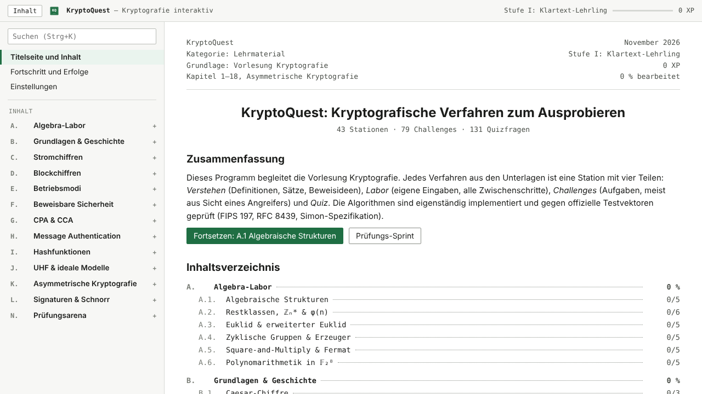

# KryptoQuest – Kryptografie interaktiv (Windows‑11‑App)

Lernspiel zur Vorlesung **Kryptografie** (Kap. 1–18, Prof. Jungk; asymmetrische Kryptografie, Prof. Henrich; Game‑Hopping‑Beweise; Praktikum 3).
Jedes Verfahren aus den Unterlagen ist eine **Station** mit vier Teilen:

| | |
|---|---|
| **Verstehen** | Definitionen, Sätze, Beweisideen, Klausur‑Tipps – und als „Erratum“ markierte Hinweise, wo die Unterlagen Fehler enthalten |
| **Labor** | Freies Experimentieren mit echten Implementierungen, jeder Zwischenschritt sichtbar, Schritt‑für‑Schritt‑Animation |
| **Challenges** | Konkrete Aufgaben, meist als Angreifer – gelöst = XP, Rang, Erfolge |
| **Quiz** | Prüfungsnahe Fragen mit Erklärung, gesammelt im Prüfungs‑Sprint |

Umfang: **43 Stationen in 13 Abschnitten, 79 Challenges, 131 Quizfragen**, 9 Stufen, 15 Erfolge. Der Spielstand wird lokal gespeichert und lässt sich exportieren/importieren.



## Installation unter Windows 11

Die Windows‑Pakete baut GitHub Actions auf einem Windows‑Runner (`.github/workflows/build-windows.yml`):

1. Im Repository unter **Actions → Windows-Build** den neuesten erfolgreichen Lauf öffnen.
2. Unten das Artefakt **KryptoQuest-Windows** herunterladen und entpacken.
3. Entweder `KryptoQuest-Setup-1.0.0.exe` (Installer mit Startmenü‑ und Desktop‑Verknüpfung) oder `KryptoQuest-1.0.0-portable.exe` (ohne Installation) starten.

Wird ein Tag `v*` gepusht (z. B. `v1.0.0`), legt der Workflow die beiden EXE‑Dateien zusätzlich als GitHub‑Release an.

> **SmartScreen:** Die EXE ist nicht code‑signiert. Windows zeigt deshalb beim ersten Start „Der Computer wurde durch Windows geschützt“. Über *Weitere Informationen → Trotzdem ausführen* startet die App. Ein Zertifikat zum Signieren kostet Geld und ist für ein Lernprojekt nicht eingerichtet.

### Ohne Installation (Browser)

`app/index.html` per Doppelklick in Edge/Chrome öffnen – die App ist reines HTML/CSS/JavaScript ohne Server und ohne externe Abhängigkeiten.

### Aus dem Quellcode

```bash
npm install
npm start            # startet die Electron-App
npm test             # Krypto-Testvektoren (FIPS 197, RFC 8439, SIMON, RSA-Beispiel, …)
npm run dist:win     # Windows-Installer + portable EXE (auf Windows ausführen)
```

## Gestaltung

- Dokumentartig im Stil der RFC-Editor-Dokumente: Kopfblock mit Metadaten, nummerierte Abschnitte (A.1, A.2 …), Inhaltsverzeichnis mit Punktführern, Monospace für Metadaten und Daten
- ein einziger Akzent (Grün), sonst Schwarz/Grau; keine Verläufe, Schatten, Emoji oder Effekte
- Hell/Dunkel folgt Windows (oder fest einstellbar); die Titelleiste wird mitgeführt
- Windows-App mit eigener Titelleiste und nativen Fensterknöpfen (`titleBarOverlay`, Snap-Layouts bleiben erhalten), optional Mica ab Windows 11 22H2 (standardmäßig aus)
- Strg+K: Suche über alle Stationen

## Abschnitte und Stationen

| Abschnitt | Stationen (Challenges / Quizfragen) |
|---|---|
| A · Algebra‑Labor | Algebraische Strukturen (1/4) · Restklassen, ℤₙ* & φ(n) (2/4) · Euklid & erweiterter Euklid (2/3) · Zyklische Gruppen & Erzeuger (2/3) · Square‑and‑Multiply & Fermat (2/3) · Polynomarithmetik in 𝔽₂⁸ (2/3) |
| B · Grundlagen & Geschichte | Caesar‑Chiffre (1/2) · Substitution & Frequenzanalyse (1/3) · Schutzziele, Kerckhoffs & Sicherheitsbegriffe (1/4) |
| C · Stromchiffren | One‑Time‑Pad & perfekte Sicherheit (2/4) · Zufallsgeneratoren & Kongruenzgenerator (1/3) · ChaCha20 (2/4) |
| D · Blockchiffren | Konfusion, Diffusion & Avalanche (1/3) · Feistel‑Netzwerk (2/3) · SIMON (1/3) · AES Schritt für Schritt (3/5) |
| E · Betriebsmodi | ECB, CBC, CTR & Padding (2/4) · Malleability: CBC‑ & CTR‑Bitflipping (2/2) · Padding‑Oracle‑Angriff (nur Erklärung/Quiz, 0/3) |
| F · Beweisbare Sicherheit | Vernachlässigbarkeit & Ununterscheidbarkeit (1/3) · Unterscheider‑Arena PRG/PRF/PRP (5/3) · Geburtstagsparadoxon (1/2) · Game‑Hopping‑Werkstatt (5/4) |
| G · CPA & CCA | IND‑CPA & IND‑CCA als Spiele (4/4) |
| H · Message Authentication | MACs & CBC‑MAC (1/3) · Encrypt‑then‑MAC & AEAD (1/3) |
| I · Hashfunktionen | Hashfunktionen & ihre Sicherheit (2/3) · Merkle‑Damgård (1/2) · Length‑Extension & HMAC (1/3) |
| J · UHF & ideale Modelle | Universelle Hashfunktionen & Poly‑UHF (1/3) · Random Oracle, Even‑Mansour & Sponge (2/3) |
| K · Asymmetrische Kryptografie | Diffie‑Hellman inkl. MITM (2/4) · DLOG/CDH/DDH & Gruppenwahl (2/4) · Elliptische Kurven (2/3) · RSA & Faktorisierungsangriffe (3/4) · ElGamal (2/3) · Malleability, FO & OAEP (2/4) · Hybride Verschlüsselung & KEM (1/2) |
| L · Signaturen & Schnorr | Digitale Signaturen & EUF‑CMA (2/4) · Schnorr‑Protokoll & ‑Signatur (3/4) |
| N · Prüfungsarena | Prüfungs‑Sprint · Zuordnungsspiele (4) · Interaktiver Spickzettel |

## Gefundene Fehler in den Unterlagen

In den jeweiligen Stationen als „Erratum“ markiert:

- **Gesamtzusammenfassung, Fermat in Körpererweiterungen:** dort „a^(p−2) ≡ a⁻¹ mod f(x)“. Richtig: in 𝔽_q mit q = pⁿ gilt a⁻¹ = a^(q−2), für AES also a²⁵⁴.
- **Gesamtzusammenfassung, Ring‑Definition:** „(R\{0},·) ist Monoid“ ist zu streng (dann wäre ℤ₆ kein Ring). Üblich: (R,·) ist Monoid.
- **Board KRYP26, Textbook‑RSA‑Signatur und RSA‑PSS:** signiert wird mit d (s = mᵈ bzw. H(m‖r)ᵈ), verifiziert mit e – auf den Folien vertauscht.
- **Board KRYP23‑24, ElGamal mit Fujisaki‑Okamoto:** Dec‑Check muss c₁ ≠ gʳ lauten (nicht pkʳ).
- **Board KRYP25, ElGamal‑KEM:** `return (c, m)` statt `return (c₁, c₂)`.

## Technik und Qualitätssicherung

- Reines HTML/CSS/JavaScript ohne Frameworks und ohne Netzwerkzugriff (CSP `connect-src 'none'`), in Electron 44 verpackt (`contextIsolation`, `sandbox`, kein Node im Renderer).
- Eigene Lehr‑Implementierungen in `app/js/crypto/`: AES‑128 inkl. Modi, SHA‑256 mit offengelegtem Zustand, HMAC, ChaCha20, SIMON 32/64, 𝔽₂⁸, BigInt‑Zahlentheorie (Miller‑Rabin, Euklid, CRT, Pohlig‑Hellman), elliptische Kurven über 𝔽ₚ.
- `tests/crypto.test.js` (28 Tests): offizielle Testvektoren (FIPS 197 Anhang B/C.1, RFC 8439, Simon‑Paper) und Abgleich mit Node.js‑`crypto` (AES‑ECB/CBC/CTR, SHA‑256, HMAC, ChaCha20).
- `tests/e2e.challenges.js`: öffnet alle 43 Stationen (inkl. Prüfung auf versehentlich angezeigte `null`/`undefined`) und löst 16 Challenges über die Oberfläche (benötigt Playwright).

## Ehrliche Grenzen

- **Lernzweck:** Die Implementierungen sind nicht konstant‑zeit und nutzen absichtlich kleine Parameter (8/16‑Bit‑Blöcke, p = 23 …). Nicht für echte Geheimnisse verwenden.
- **Padding‑Oracle:** Die Station erklärt Angriff, Formel und Gegenmaßnahmen, enthält aber kein interaktives Angriffswerkzeug.
- Die Windows‑Oberfläche wurde unter Linux in Chromium und in Electron (Xvfb) getestet, nicht auf einem echten Windows‑11‑Rechner. Die nativen Fensterknöpfe und Mica sind daher ungetestet; Mica ist deshalb standardmäßig aus.
- Die App ersetzt nicht das Skript – sie ist ein Übungs‑ und Verständniswerkzeug.
